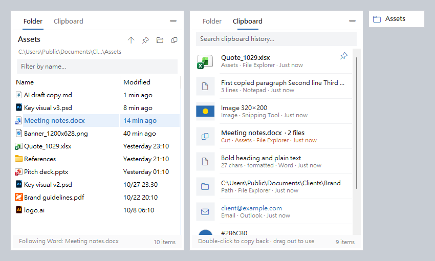

# FileFollow

**English** · [繁體中文](README.zh-TW.md)

A small floating panel for Windows that always shows the folder of the file you are working on. Switch to a Word document, a PDF or a CAD drawing and the panel jumps to its folder, sorted by last modified, ready to drag a file into a browser upload or an email. A second tab keeps a history of everything you copied or cut.



No more clicking through Documents › Clients › Brand › 2026 › October › Assets in File Explorer just to find the file you have open.

## Features

**Folder tab**
- Follows the file in the foreground window: Word, Excel, PowerPoint, ArchiCAD, AutoCAD, Notepad and more
- Newest files first, with the current file highlighted, so files an AI tool just generated show up at the top
- Drag files straight out to upload or attach them (drag copies, never moves)
- Double-click to open, Ctrl+C to copy files for pasting into chats or email
- Click the path to jump to any parent folder; pin to stop following
- Collapses to a small pill; optional auto-hide

**Clipboard tab**
- Records text (with formatting), links, email addresses, paths, colors, files (copy or cut) and images
- <kbd>Ctrl</kbd>+<kbd>Alt</kbd>+<kbd>C</kbd> → pick an item → <kbd>Enter</kbd> pastes it into the window you were in
- Search, pin, merge several items, drag out
- Skips content that password managers mark as private; history stays on your computer

The interface follows your Windows display language (Traditional Chinese or English). Switch from the tray menu.

## Install

FileFollow is a single portable `.exe` that runs on Windows 10 and 11 with the .NET Framework 4.x that ships with Windows.

1. Download or clone this repository
2. Run `build.cmd`. No SDK or Visual Studio needed; the C# compiler that comes with .NET Framework is enough. It produces `FileFollow.exe` next to the script
3. Double-click `FileFollow.exe`. The panel appears in the bottom-right corner and a blue folder icon appears in the tray
4. Optional: right-click the tray icon → **Start with Windows**

## Usage

The full illustrated guide is in [docs/guide.en.html](docs/guide.en.html) (download and open it in a browser).

| Shortcut | Action |
|---|---|
| <kbd>Ctrl</kbd>+<kbd>Alt</kbd>+<kbd>F</kbd> | Show or collapse the panel |
| <kbd>Ctrl</kbd>+<kbd>Alt</kbd>+<kbd>C</kbd> | Clipboard history; Enter pastes into the previous window |
| <kbd>Ctrl</kbd>+<kbd>Tab</kbd> | Switch tabs |
| <kbd>Ctrl</kbd>+<kbd>F</kbd> | Filter |
| <kbd>Enter</kbd> / <kbd>Shift</kbd>+<kbd>Enter</kbd> | Open file / paste item (plain text) |
| <kbd>Ctrl</kbd>+<kbd>C</kbd> | Copy files / copy item back |
| <kbd>Ctrl</kbd>+<kbd>P</kbd> | Pin a clipboard item |
| <kbd>Backspace</kbd> | Up one folder |
| <kbd>Esc</kbd> | Clear filter, then collapse |

## How it finds the file

It tries these in order and stops at the first hit:

1. **A full path in the window title** (AutoCAD, Notepad++, terminals)
2. **Office automation**: asks Word, Excel and PowerPoint which documents are open; OneDrive URLs are mapped back to the local sync folder
3. **The process command line**, for apps opened by double-clicking a file (including the Windows 11 Notepad `/SESSION` argument)
4. **Windows Recent Items**, matching the file name shown in the title
5. **The Windows Search index**, looking up the file name from the title and picking the most recently modified match

If nothing matches (a browser, a chat app, File Explorer), the panel stays where it is, so it doesn't jump away while you drag a file into a browser.

Tip: for VS Code, set `window.title` to `${activeEditorLong}` so the title carries the full path.

## Privacy and security

- No network access. Nothing leaves your computer.
- Settings and clipboard history live in `%APPDATA%\FileFollow\`. History is stored unencrypted, up to 300 entries (pinned items are kept). Use **Pause clipboard recording** in the tray menu for sensitive work.
- Clipboard content flagged with `ExcludeClipboardContentFromMonitorProcessing`, `Clipboard Viewer Ignore` or `CanIncludeInClipboardHistory = 0` is never recorded.
- Network paths (`\\host\share`) found in window titles are ignored, so a web page title cannot make Windows connect to a remote host and leak NTLM credentials.
- Opening an executable from a clipboard path asks for confirmation first.

## Development

| File | Purpose |
|---|---|
| `src/FileFollow.cs` | Panel, folder tab, foreground-window detection |
| `src/ClipHistory.cs` | Clipboard tab |
| `src/I18n.cs` | Language selection |
| `docs/make-shots.ps1` | Renders the screenshots |
| `docs/build-guide.ps1` | Builds the illustrated guides |

The code targets C# 5 because that is what the built-in compiler supports (no `$""`, `?.` or tuples).

Debug switches:

```bat
FileFollow.exe --probe out.txt                       :: file detected for every visible window
FileFollow.exe --snapshot <folder> <file> out.png    :: render the panel to images
```

Set `FILEFOLLOW_LANG=en` or `zh` to force the interface language.

## License

[MIT](LICENSE)
