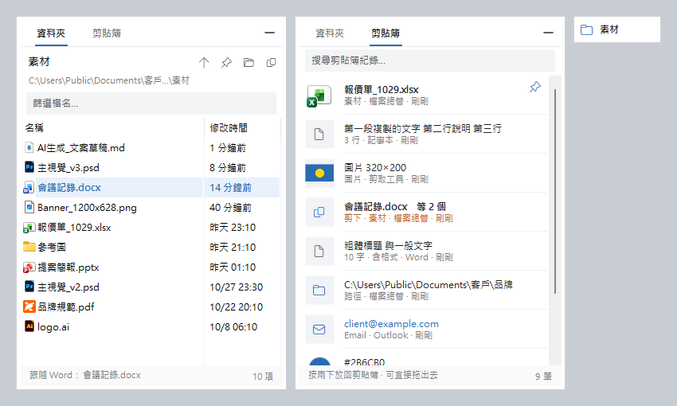

# 跟檔夾 FileFollow

[English](README.md) · **繁體中文**

浮在 Windows 螢幕角落的小面板：切到哪個檔案，它就跳到那個檔案所在的資料夾，依修改時間排序，可以直接拖去上傳或附加。另一個分頁記下你複製、剪下過的所有內容。



不用再打開檔案總管，從「文件 › 客戶 › 品牌 › 2026 › 10月 › 素材」一層層點下去找。

## 功能

**資料夾分頁**
- 跟著前景視窗的檔案跳：Word、Excel、PowerPoint、ArchiCAD、AutoCAD、記事本等
- 新的檔案排最上面，正在編輯的檔案用藍底標示；AI 剛產出的檔案會出現在頂端
- 直接拖出去上傳或附加（拖曳是複製，不會搬走原檔）
- 雙擊開啟；Ctrl+C 複製檔案，可以貼到 LINE 或信件
- 點路徑跳到任一上層資料夾；釘選後就不跟著跳
- 收起時顯示在工作列上（工作列無法使用時改用浮動膠囊）；也可以設定自動收起

**剪貼簿分頁**
- 記錄文字（含格式）、網址、Email、路徑、色碼、檔案（區分複製或剪下）、圖片
- <kbd>Ctrl</kbd>+<kbd>Alt</kbd>+<kbd>C</kbd> → 選擇 → <kbd>Enter</kbd>，直接貼回剛才的視窗
- 搜尋、釘選、多筆合併、拖出去
- 密碼管理員標記為「不要記錄」的內容會略過；紀錄只存在本機

介面語言跟著 Windows 顯示語言（繁體中文或英文，也可以從系統匣選單切換），顏色預設跟著 Windows 的淺色或深色模式，也可以在系統匣選單「外觀」固定成淺色或深色。

## 安裝

編譯出來是一個免安裝的 `FileFollow.exe`，Windows 10、11 內建的 .NET Framework 4.x 就能執行。

1. 下載或 clone 這個 repo
2. 執行 `build.cmd`。不需要安裝 SDK 或 Visual Studio，用 .NET Framework 內建的 C# 編譯器即可，會在同一個資料夾產生 `FileFollow.exe`
3. 雙擊 `FileFollow.exe`，面板出現在右下角，系統匣多一個藍色資料夾圖示
4. 想開機自動啟動：系統匣圖示按右鍵 →「開機時自動啟動」

## 用法

完整的圖解說明在 [docs/guide.zh.html](docs/guide.zh.html)（下載後用瀏覽器開啟）。

| 快速鍵 | 作用 |
|---|---|
| <kbd>Ctrl</kbd>+<kbd>Alt</kbd>+<kbd>F</kbd> | 顯示或收起面板 |
| <kbd>Ctrl</kbd>+<kbd>Alt</kbd>+<kbd>C</kbd> | 剪貼簿紀錄，Enter 貼到前一個視窗 |
| <kbd>Ctrl</kbd>+<kbd>Tab</kbd> | 切換分頁 |
| <kbd>Ctrl</kbd>+<kbd>F</kbd> | 篩選 |
| <kbd>Enter</kbd> / <kbd>Shift</kbd>+<kbd>Enter</kbd> | 開啟檔案／貼上（純文字） |
| <kbd>Ctrl</kbd>+<kbd>C</kbd> | 複製檔案／放回剪貼簿 |
| <kbd>Ctrl</kbd>+<kbd>P</kbd> | 釘選剪貼簿項目 |
| <kbd>Backspace</kbd> | 上一層 |
| <kbd>Esc</kbd> | 清空篩選，再按一次收起 |

## 怎麼知道目前是哪個檔案

依序嘗試，抓到就停：

1. **視窗標題裡的完整路徑**：AutoCAD、Notepad++、終端機
2. **Office**：直接詢問 Word、Excel、PowerPoint 開著哪些檔案；OneDrive 網址會換回本機路徑
3. **啟動參數**：用雙擊開啟的程式（包含 Win11 新版記事本的 `/SESSION` 參數）
4. **Windows「最近使用的項目」**：比對標題裡的檔名
5. **Windows 搜尋索引**：用標題裡的檔名查索引，取修改時間最新的那個

都抓不到時（瀏覽器、LINE、檔案總管），面板會停在原本的資料夾，所以拖檔案去瀏覽器上傳時不會跳走。

小技巧：VS Code 可以把 `window.title` 設成 `${activeEditorLong}`，讓標題帶完整路徑。

## 隱私與安全

- 唯一的連網是檢查更新：啟動後與之後每天一次，向 GitHub 查詢這個 repo 的最新版本（只送出程式名稱與版本號），有新版時在系統匣提示，不會自動下載或安裝。可以從系統匣選單關閉「自動檢查更新」。其他資料都留在本機。
- 設定和剪貼簿紀錄存在 `%APPDATA%\FileFollow\`，未加密，最多 300 筆（釘選的保留）。處理機密資料時，可以從系統匣選單「暫停記錄剪貼簿」。
- 標記 `ExcludeClipboardContentFromMonitorProcessing`、`Clipboard Viewer Ignore` 或 `CanIncludeInClipboardHistory = 0` 的內容不會被記錄。
- 視窗標題裡的網路路徑（`\\主機\共用`）一律忽略，網頁標題無法誘使 Windows 連到外部主機而外洩 NTLM 憑證。
- 從剪貼簿路徑開啟執行檔前會先確認。

## 開發

| 檔案 | 用途 |
|---|---|
| `src/FileFollow.cs` | 面板、資料夾分頁、前景視窗偵測 |
| `src/ClipHistory.cs` | 剪貼簿分頁 |
| `src/I18n.cs` | 介面語言 |
| `src/Theme.cs` | 淺色、深色配色 |
| `src/Glass.cs` | 毛玻璃背景 |
| `src/Version.cs` | 版本號（主版.次版.修正，例如 1.3.0），程式、安裝檔、檢查更新共用；GitHub 發行版標籤為 `v` + 版本號 |
| `src/Update.cs` | 檢查更新 |
| `docs/make-shots.ps1` | 產生截圖 |
| `docs/build-guide.ps1` | 產生圖解說明頁 |

內建編譯器只支援 C# 5，所以不能用 `$""`、`?.`、tuple 等語法。

除錯參數：

```bat
FileFollow.exe --probe out.txt                       :: 列出每個可見視窗偵測到的檔案
FileFollow.exe --snapshot <資料夾> <檔案> out.png      :: 把面板畫成圖片
```

設定環境變數 `FILEFOLLOW_LANG=en` 或 `zh` 可以強制介面語言。

## 授權

[MIT](LICENSE)
